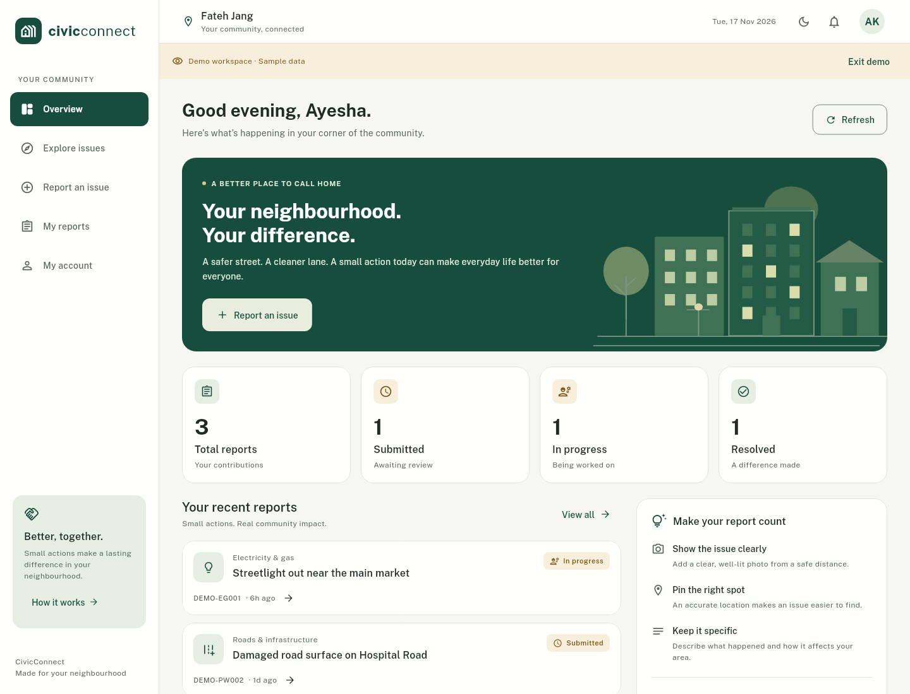
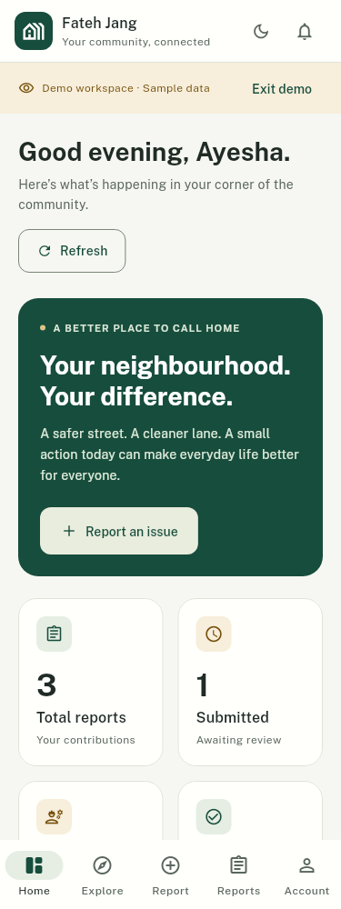
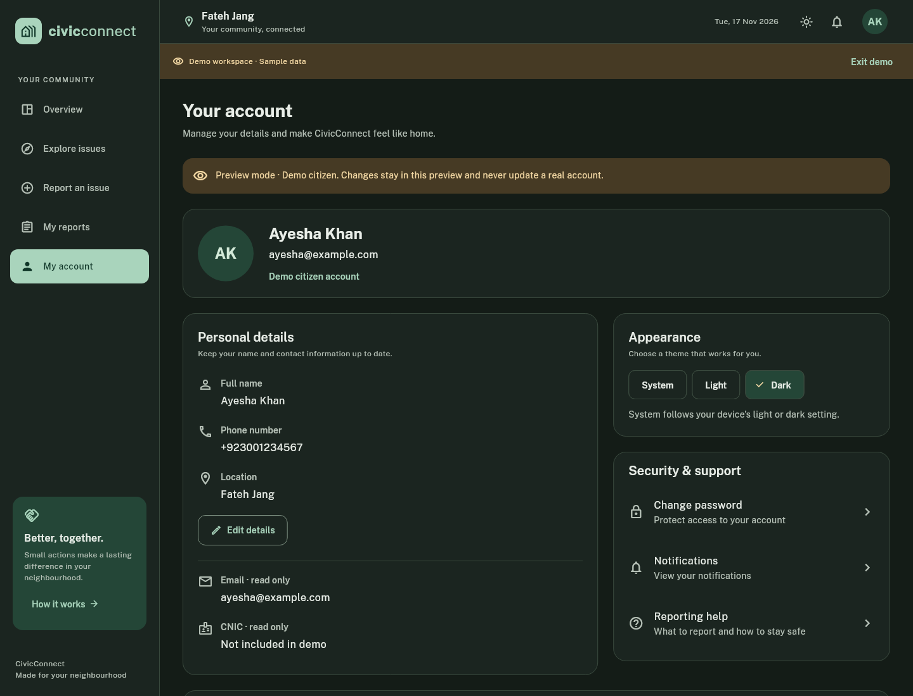
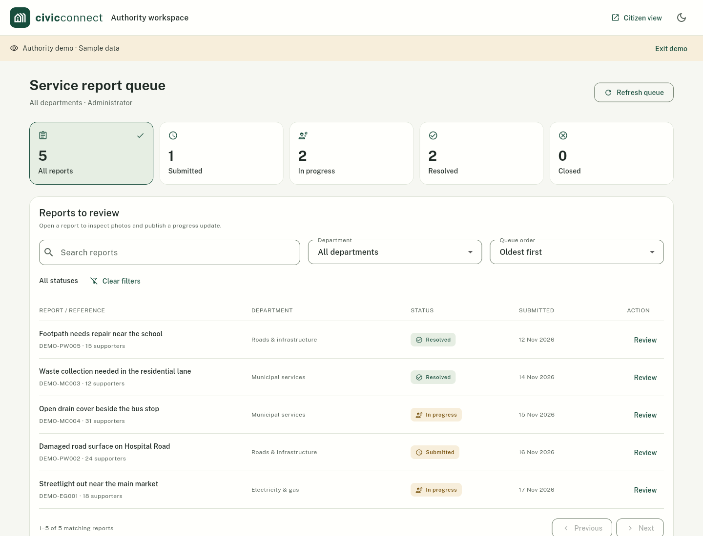

<div align="center">
  
  <h1>CivicConnect</h1>
  <p><strong>Your community, connected.</strong></p>
  <p>Report local issues in Fateh Jang, follow their progress, and support community reports.</p>
  <p>
    <a href="#features">Features</a> ·
    <a href="#try-the-preview">Try the preview</a> ·
    <a href="#connect-hosted-services">Service setup</a> ·
    <a href="#verification">Verification</a> ·
    <a href="#deployment-notes">Deployment</a>
  </p>
</div>

<p align="center">
  
</p>

CivicConnect is a Flutter citizen application with a shared Material 3 interface across phone, tablet, and desktop layouts. Supabase provides authentication, PostgreSQL data, and photo storage. The backend is defined by versioned SQL migrations with database-enforced permissions. **There is no separate application API server to start.**

<details>
<summary>Phone layout and dark appearance</summary>

| Phone overview | Account · dark theme |
| :---: | :---: |
|  |  |

</details>

## Features

| Area | What the application provides |
| --- | --- |
| Overview | Actionable personal report counts, recent activity, and status-filtered report tracking, including closed reports. |
| Explore | Report cards and details, combined search/category/status filters, sorting, refresh, and paged display. |
| Reporting | Department selection, validated photos, precise map pins or manual/GPS locations, upload progress, reference codes, and recovery of interrupted submissions. |
| Community support | Toggle support for a report; displayed counts follow the committed database transaction. |
| My Reports | Review personal submissions, read public service updates, and confirm deletion of reports owned by the signed-in citizen. |
| Authority workspace | Department-scoped review queue, administrator filters, bounded pagination, photos/location context, versioned status updates, and immutable public progress history. |
| Accounts | Email/password registration, email verification, password reset, profile editing, and password changes with reauthentication. |
| Appearance | Evergreen and warm neutral surfaces, bundled Public Sans, outlined icons, persistent light/dark/system settings, and reduced-motion support. |
| Responsive navigation | Labeled bottom navigation on phones, a compact rail on tablets, and a sidebar on wider screens. |

Departments cover municipal services, public safety, fire & emergency, electricity & gas, and roads & infrastructure. Status labels include Submitted, In progress, Resolved, and Closed.

Notifications currently show an empty state and a link to My Reports. Service updates are available in report details; there is no push delivery service or live notification feed. The [authority workspace guide](docs/authority-workspace.md) covers staff provisioning, permissions, report triage, and progress publishing.

<details>
<summary>Authority workspace preview</summary>



Open `/#/authority` or select **Authority workspace** in the app. Staff sign in with a verified account; a trusted administrator grants either one department or all-department access. The [setup and workflow guide](docs/authority-workspace.md) includes a reusable membership SQL template, permitted status changes, conflict recovery and public-note visibility.

</details>

## Stack

| Layer | Implementation |
| --- | --- |
| Client | Flutter / Dart, Material 3 |
| Authentication | Supabase Auth · email/password, confirmation, and recovery links |
| Structured data | Supabase PostgreSQL · private profiles, reports, references, and support |
| Media | Supabase Storage · owned report and account photos |
| Location | `geolocator`, manual coordinates, optional `google_maps_flutter` |
| Local persistence | `shared_preferences` · appearance and a request journal for interrupted submissions |
| Validation | `flutter_test`, `flutter_lints`, model/service/widget tests |

The [package manifest](pubspec.yaml) declares Dart **`^3.5.4`**. The [delivery record](docs/superpowers/2026-11-17-redesign-delivery.md) documents verification with **Flutter 3.47.1 / Dart 3.13.1** on November 17, 2026; the declared constraint does not establish that every compatible SDK was tested.

## Try the preview

Install a Flutter SDK compatible with the package manifest and enable a target device. From the repository root:

```bash
flutter pub get
flutter run -d chrome --dart-define=PREVIEW_MODE=true
```

Preview mode skips backend initialization and requires no account. Sample reports are visibly labeled; support and deletion affect only in-memory demo records. Report confirmation is simulated and explicitly states that nothing was submitted. Demo changes are not saved to hosted services.

A normal build also offers demo entry from the welcome screen and a recovery option when service initialization fails.

<details>
<summary>Serve a compiled web preview</summary>

```bash
flutter build web --release --dart-define=PREVIEW_MODE=true
python3 -m http.server 8080 --bind 127.0.0.1 --directory build/web
```

Open `http://127.0.0.1:8080` in a browser. This serves static Flutter output; it does not start an application API or provision Supabase.

</details>

## Connect hosted services

Use the [Supabase CLI](https://supabase.com/docs/guides/local-development/cli/getting-started) **3.x** and a new or dedicated Supabase project. The initial migrations create the tables, authentication trigger, RPCs, storage buckets, and access policies. Keep project administration on your workstation or deployment server.

### 1. Deploy the backend

```bash
supabase login
supabase link YOUR_PROJECT_REF
supabase db push --remote --dry-run
supabase db push --remote --yes
supabase config diff
supabase config push --yes
```

Review the configuration diff before pushing. [supabase/config.toml](supabase/config.toml) enables email confirmation and permits the native callback and localhost web development. Set your production site and redirect URLs before a public deployment. Configure custom SMTP for delivery to real users; Supabase's built-in mail service has recipient and rate restrictions.

Migrations live in [supabase/migrations](supabase/migrations). The CLI records applied versions, so subsequent launches apply only pending changes. **The mobile application never receives database passwords or administrator keys.** Do not reset an existing production database to initialize the app.

### 2. Configure the client

```bash
cp config/backend.example.json config/backend.local.json
```

Fill in your project URL and **public publishable key** from Supabase's API settings. The local file is ignored by Git. Dart defines are compiled into the application; database policies enforce access.

| Dart define | Default | Purpose |
| --- | --- | --- |
| `PREVIEW_MODE` | `false` | Use local sample data and skip hosted services. |
| `SUPABASE_URL` | Empty | Hosted project URL, required for real sessions. |
| `SUPABASE_PUBLISHABLE_KEY` | Empty | Public client key. The older `SUPABASE_ANON_KEY` name is also accepted. |
| `GOOGLE_MAPS_ENABLED` | Native: `true`; web: `false` | Show the interactive map on supported targets. Web requires its Maps JavaScript SDK; use `false` to keep coordinate/GPS entry only. |

Never put a secret key, service-role key, database password, or Supabase access token in client configuration.

### 3. Run the application

```bash
flutter pub get
flutter run -d chrome --web-port=8080 \
  --dart-define-from-file=config/backend.local.json
```

For an already running Android emulator, apply pending migrations and launch in one command:

```bash
./scripts/start_android.sh
```

The script defaults to `emulator-5554`. Override `ANDROID_DEVICE`, `FLUTTER_CLI`, `SUPABASE_CLI`, or `BACKEND_CONFIG` when needed. It uses the project URL in the selected configuration to target migrations and then starts Flutter. The hosted backend continues running independently of the terminal.

See [Backend operations](docs/backend.md) for the schema, permissions, email setup, security checks, and maintenance.

> **Historical credentials:** privileged Supabase and external image-compression credentials appeared in an earlier revision. They are absent from the current client but remain in Git history; revoke them in their original provider accounts. This deployment uses a separate Supabase project. Photos are not sent to an external compression service.

## Location and native prerequisites

On Android and iOS, **Choose on map** opens an interactive map. Tap to place a pin, touch and hold it to drag, and zoom in for a precise location. **Confirm location** saves the selected coordinates back to the report form; **Cancel** preserves its previous location. Editing a location reopens the existing pin. Pins outside the service area cannot be confirmed.

Use **Use coordinates instead** for manual entry, or **Use current location** for GPS. All entry methods use the same [Fateh Jang service polygon](lib/features/reports/data/report_submission_service.dart), and opening the picker never requests GPS permission. Preview keeps coordinate entry offline and does not initialize a map.

Native maps are enabled by default and require a valid, restricted platform key. To opt in on web after configuring its SDK, include:

```bash
flutter run --dart-define=GOOGLE_MAPS_ENABLED=true
```

Include `--dart-define-from-file=config/backend.local.json` when testing real uploads.

| Target | Prerequisites and configuration |
| --- | --- |
| Web | Load the Google Maps JavaScript SDK with your restricted public API key before Flutter starts in [web/index.html](web/index.html). GPS requires browser permission and a secure context such as HTTPS or localhost. |
| Android | Install the Android SDK and JDK 17. Review Maps metadata in [AndroidManifest.xml](android/app/src/main/AndroidManifest.xml) and apply your deployment's restricted key. The manifest declares internet and foreground location access, without background location. |
| iOS | Use macOS/Xcode and complete Supabase callback and Maps platform setup. Review the Maps key in [AppDelegate.swift](ios/Runner/AppDelegate.swift) and camera, photo-library, and foreground-location descriptions in [Info.plist](ios/Runner/Info.plist). |

Set `GOOGLE_MAPS_ENABLED=false` to disable maps for a deployment; manual and GPS entry remain available. Existing native Maps key entries must be reviewed for your project and platform restrictions before deployment.

<details>
<summary>Android build tool versions</summary>

The recorded Android build uses JDK 17, Gradle 8.14.3, Android Gradle Plugin 8.11.1, and Kotlin 2.2.20. Configuration lives in [settings.gradle](android/settings.gradle), [the Gradle wrapper](android/gradle/wrapper/gradle-wrapper.properties), and [app/build.gradle](android/app/build.gradle).

Groovy Gradle files are authoritative; obsolete parallel Kotlin DSL files were removed during the redesign.

</details>

## Workflow constraints

- **Report content:** title 5–120 characters, description 20–2,000 characters, one department, and a location within the Fateh Jang boundary.
- **Report photos:** 1–3 JPEG, PNG, or WebP files, up to 8 MB each (`8 × 1024 × 1024` bytes). All files are validated before uploading; convert HEIC images first.
- **Profile photos:** optional JPEG, PNG, or WebP, up to 5 MB, added from Account after email verification. They use a separate bucket.
- **Account verification:** Supabase Auth owns passwords and email confirmation. Citizen profiles are created atomically at registration and remain inaccessible until confirmation. Password confirmation is never persisted.
- **Submission:** photos upload first, then one database transaction allocates the reference and saves the report. A request journal makes uncertain retries idempotent, including across browser tabs. **Recover saved submission** checks earlier requests without requiring their original photos or replacing the current form. Unsubmitted form drafts are not persisted across restarts.
- **Support and deletion:** support toggles use transactions. Deletion requires confirmation and an ownership check. A durable cleanup manifest lets the client retry failed photo removal; a retired request ID prevents a delayed submission from recreating a deleted report.

<details>
<summary>Compatibility with existing records</summary>

The UI normalizes legacy status values such as `solved`, `done`, `resolved`, and `in_progress`. Older records with missing images or dates remain readable. Query, category, status, and sort controls compose together.

The stored category value `Municipal Corportaion` is intentionally preserved for compatibility with existing records and counters; the interface displays “Municipal services.” See [report_filters.dart](lib/features/reports/domain/report_filters.dart).

</details>

## Architecture

```text
lib/
├── app/                 Bootstrap, routes, responsive shell, session/theme state
├── core/                Shared theme tokens, layout, controls, and feedback
├── features/
│   ├── auth/            Welcome, registration, verification, sign-in, recovery
│   ├── dashboard/       Personal overview and reporting guidance
│   ├── authority/       Scoped staff queue, RPC client, versioned progress editor
│   ├── reports/         Application state, data, filters, screens, widgets
│   └── account/         Profile, appearance, security, notifications
├── models/              Citizen and report data contracts
├── services/            Supabase auth, profiles, reports, and storage boundaries
├── screens/ & themes/   Compatibility exports for former imports
└── utils/               Identity/contact validators
```

The [app bootstrap](lib/app/civic_connect_app.dart) initializes hosted clients for real sessions and offers retry/demo recovery. [AppSession](lib/app/app_session.dart) owns preview and appearance state. Report loading/mutations sit in [ReportsController](lib/features/reports/application/reports_controller.dart); photo validation, geographic checks, and report creation sit in [ReportSubmissionService](lib/features/reports/data/report_submission_service.dart).

## Verification

After fetching dependencies:

```bash
flutter analyze
flutter test
flutter build web --release --dart-define-from-file=config/backend.local.json
flutter build web --release --dart-define=PREVIEW_MODE=true
flutter build apk --debug --dart-define-from-file=config/backend.local.json
```

The [authority delivery record](docs/superpowers/2026-11-17-authority-delivery.md) covers the staff workspace, live concurrency and browser checks. The [Supabase delivery record](docs/superpowers/2026-11-17-supabase-delivery.md) records the original backend migration checks. The earlier [UI delivery record](docs/superpowers/2026-11-17-redesign-delivery.md) covers the interface redesign. Verification is recorded evidence for those revisions, not a guarantee for a different deployment.

Coverage includes report parsing and filters, photo validation, geographic boundaries, preview isolation, submission recovery, authentication errors, theme contrast, responsive navigation, and reduced motion. Widget checks include 375 px dark layouts at 2× text size. [SQL integration tests](supabase/tests) exercise database permissions and report transactions against the deployed schema.

<details>
<summary>Optional UI capture and formatting checks</summary>

```bash
flutter test test/widget_test.dart --dart-define=CAPTURE_UI=true
dart format --output=none --set-exit-if-changed lib test
git diff --check
```

UI capture loads bundled text/icon fonts and writes images to `/tmp/civic-connect-previews/`. These captures are local artifacts; the curated README images live under `docs/images/`.

</details>

## Deployment notes

- **Validate your deployment:** configure SMTP and redirect URLs, then test confirmation/recovery emails, native permission prompts, and any enabled Maps SDK. Preview tests do not write remote records.
- **Web:** publish the generated `build/web` directory to a static host. Set Flutter's `--base-href` when hosting below a subpath, use HTTPS, and rebuild with the intended public configuration.
- **Android:** local testing uses a debug APK. The current [release build configuration](android/app/build.gradle) also uses debug signing and the example application ID; configure your own identifier and production signing before distribution.
- **iOS:** no iOS build was verified in the Linux delivery environment. Complete native setup and validation on macOS before claiming iOS readiness.
- **Operations:** provision staff through the trusted [membership template](supabase/admin/authority_membership.sql). The authority workspace publishes versioned status updates and public notes; citizen accounts cannot assign statuses. Push notifications are not implemented. Review unreferenced uploads as part of storage maintenance.

Further context: [delivery evidence](docs/superpowers/2026-11-17-redesign-delivery.md), [design specification](docs/superpowers/specs/2026-11-17-civic-redesign-design.md), and [implementation plan](docs/superpowers/plans/2026-11-17-civic-redesign.md).

Public Sans is bundled under the [SIL Open Font License](assets/fonts/OFL.txt); that font license does not establish a license for the application source.
